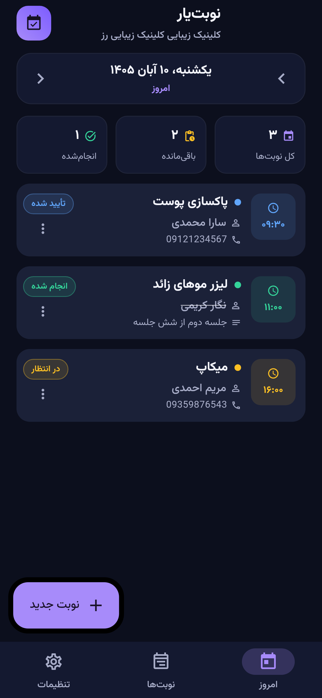
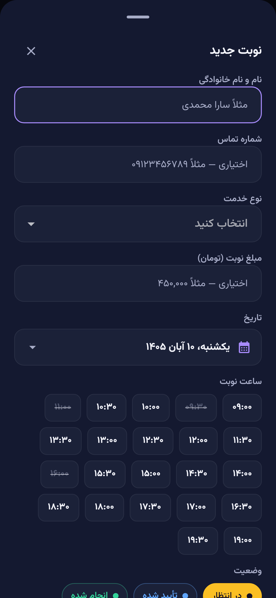
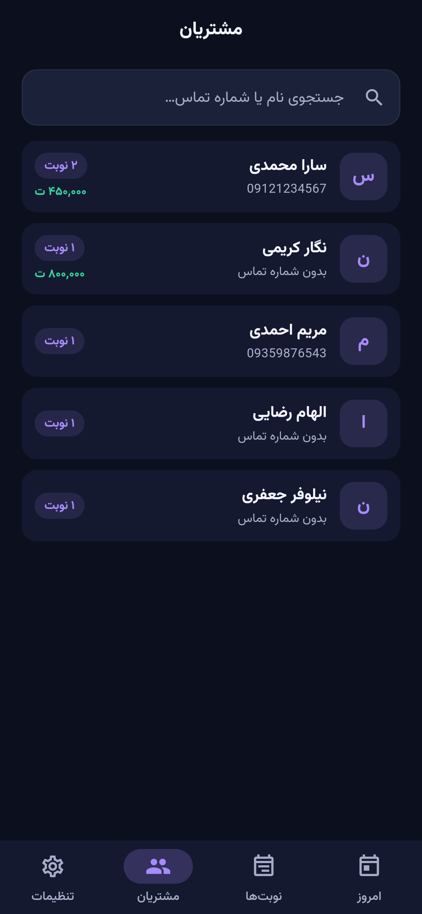
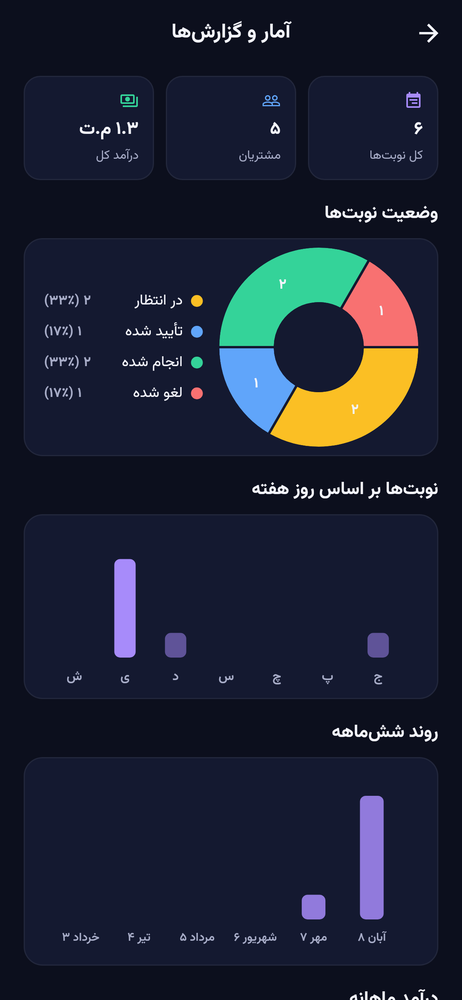
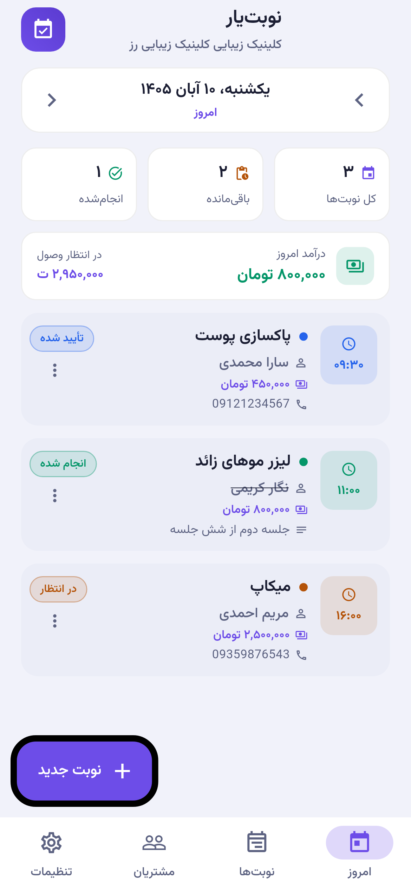

# نوبت‌یار — اپلیکیشن مدیریت نوبت برای کسب‌وکارهای محلی

[](https://github.com/Pourya-Rezaei/nobatyar/actions/workflows/build-android.yml)

اپلیکیشن اندروید ساخته‌شده با **Flutter** برای مدیریت نوبت‌های مشتریان در کسب‌وکارهای محلی مانند **کلینیک زیبایی، آرایشگاه و کلینیک دندان‌پزشکی**. همه داده‌ها به‌صورت محلی روی گوشی ذخیره می‌شود و به هیچ سرور یا اینترنتی نیاز نیست.

## امکانات

- **صف نوبت‌های روزانه** با نمایش تقویم شمسی و جابه‌جایی بین روزها
- **ثبت نوبت جدید** در چند ثانیه: نام مشتری، شماره تماس، نوع خدمت، تاریخ شمسی، بازه ساعت، قیمت و یادداشت
- **انتخاب ساعت از بازه‌های آزاد** — ساعات رزروشده و بلاک‌شده برای همان روز به‌صورت خودکار غیرفعال می‌شوند
- **مدیریت وضعیت نوبت**: در انتظار، تأیید شده، انجام شده، لغو شده
- **فهرست همه نوبت‌ها** با جستجو (نام، خدمت، شماره، یادداشت) و فیلتر بر اساس وضعیت
- **یادآوری نوتیفیکیشن** — قبل از هر نوبت (۳۰ دقیقه تا ۱ روز، قابل تنظیم) + خلاصه صبحگاهی صف امروز؛ کاملاً آفلاین
- **اشتراک یادآوری با مشتری** — متن آماده یادآوری با یک لمس به واتساپ/پیامک می‌رود
- **پرونده مشتریان** — سوابق نوبت‌های هر مشتری، تعداد مراجعه، آخرین خدمت و تماس مستقیم
- **گزارش و نمودار** — درآمد روز/ماه، روند ۷ روز اخیر، ساعات پرمراجعه و روند ۶ ماه اخیر
- **قیمت خدمات** — قیمت پیش‌فرض هر خدمت + امکان تغییر در هر نوبت
- **استراحت و تعطیلی** — بلاک استراحت هفتگی (مثلاً ناهار) و تعطیلی تاریخ‌های خاص
- **پشتیبان‌گیری و بازگردانی** — خروجی فایل JSON یا **رمزنگاری‌شده با AES-256** و برگرداندن آن روی هر گوشی
- **بکاپ خودکار هفتگی** — هر ۷ روز بدون دخالت شما، فایل پشتیبان روی گوشی ساخته می‌شود (۳ نسخهٔ آخر) و پیشنهاد ارسال به جای امن نمایش داده می‌شود؛ با رمز اختیاری AES-256
- **بررسی به‌روزرسانی** — هنگام شروع اپ و از تنظیمات، نسخهٔ جدید از گیت‌هاب بررسی و بنر دانلود در صفحهٔ خانه نمایش داده می‌شود
- **ثبت خطا (Crash Log) محلی** — خطاهای غیرمنتظره روی دیسک ثبت می‌شوند (فقط متن فنی، بدون هیچ دادهٔ مشتری) و در اجرای بعدی پیشنهاد فرستادن گزارش برای توسعه‌دهنده نمایش داده می‌شود
- **تم تیره، روشن یا هماهنگ با سیستم**
- **تقویم کاملاً شمسی** با تبدیل دقیق شمسی ↔ میلادی (بدون هیچ پکیج خارجی)
- **تنظیمات کسب‌وکار**: نام، نوع (زیبایی / آرایشگاه / دندان‌پزشکی)، ساعات کاری و مدت هر نوبت
- فهرست خدمات پیش‌فرض هر نوع کسب‌وکار + امکان ثبت خدمت دلخواه
- رابط کاملاً **فارسی و راست‌چین** با فونت وزیرمتن
- **ذخیره‌سازی محلی** با `shared_preferences` — داده‌ها بعد از بستن اپ باقی می‌مانند
- اندروید ۷ به بالا (API 24) و iOS 15 به بالا

## پیش‌نمایش

| صف امروز | فرم ثبت نوبت | پرونده مشتریان |
|:---:|:---:|:---:|
|  |  |  |

| گزارش‌ها و نمودار | تم روشن |
|:---:|:---:|
|  |  |

## بیلد و انتشار خودکار (CI)

این ریپو روی **GitHub Actions** به‌صورت خودکار بیلد می‌شود:

- **هر push به `main`** → اجرای `flutter analyze` و کل تست‌ها + ساخت APK امضاشده (فقط برای تغییرات کد)
- **هر tag با فرمت `v*`** → ساخت APK امضاشده اندروید و IPA بدون امضای iOS و افزودن خودکار به Release
- کلید امضا در **GitHub Secrets** نگه‌داری می‌شود (keystore هرگز وارد ریپو نمی‌شود) و همه بیلدها با همان کلید قبلی امضا می‌شوند — یعنی به‌روزرسانی روی نسخه‌های قبلی بدون حذف نصب می‌شود
- **پشتیبان آفلاین کلید امضا**: workflow دستی `Export signing backup` نسخهٔ رمزنگاری‌شدهٔ کلید را با AES-256-CBC/PBKDF2 تحویل می‌دهد تا در جای امن (رمز عبور + فلش) نگه‌داری شود
- برای ساخت دستی: تب **Actions → Build Android → Run workflow**

## امنیت و حریم خصوصی

- **بدون ردیابی، بدون سرور** — داده‌های مشتریان هرگز از گوشی خارج نمی‌شود؛ تنها مجوز اپ، نمایش نوتیفیکیشن است
- **تنها تماس شبکه‌ای: بررسی به‌روزرسانی** — هنگام شروع (حداکثر هر ۲۴ ساعت یک‌بار) فقط شمارهٔ آخرین نسخه از API عمومی گیت‌هاب پرسیده می‌شود؛ نه داده‌ای ارسال می‌شود، نه شناسه‌ای؛ در صورت قطع اینترنت بی‌صدا رد می‌شود
- **پشتیبان رمزدار** — فایل پشتیبان می‌تواند با AES-256-GCM قفل شود؛ کلید با PBKDF2 (۱۵۰ هزار تکرار) از رمز شما ساخته می‌شود و روی فایل ذخیره نمی‌شود — بدون رمز، فایل روی هیچ دستگاهی باز نمی‌شود
- **اعتبارسنجی ورودی** — فایل پشتیبان قبل از اعمال، ساختار و محدودهٔ همهٔ فیلدها (تاریخ، ساعت، مبلغ، طول متن‌ها) بررسی می‌شود تا فایل خراب یا دستکاری‌شده داده‌ها را خراب نکند
- **غیرفعال بودن بکاپ سیستمی اندروید** (`allowBackup=false`) — داده‌های مشتریان در بکاپ خودکار گوگل قرار نمی‌گیرد؛ برای انتقال، از پشتیبان داخلی اپ استفاده کنید
- **بیلد obfuscate‌شده** — کد دارت در نسخهٔ انتشار با `--obfuscate` ساخته می‌شود تا مهندسی معکوس سخت‌تر شود

## پرفورمنس

- لیست‌های بلند (همهٔ نوبت‌ها، مشتریان، پروندهٔ مشتری) با `ListView.builder` به‌صورت تنبل ساخته می‌شوند — با هزار نوبت هم روان می‌ماند
- تم‌ها فقط یک‌بار در عمر برنامه ساخته و کش می‌شوند؛ تغییر داده‌ها دیگر کل اپ را بازسازی نمی‌کند
- گروه‌بندی مشتریان کش می‌شود و فقط با تغییر داده بازمحاسبه می‌شود
- جستجو با تأخیر هوشمند (۲۵۰ms) اجرا می‌شود و چیدمان نوتیفیکیشن‌ها بعد از ویرایش پیوستهٔ تنظیمات با debounce انجام می‌شود
- راه‌اندازی نوتیفیکیشن بعد از نخستین فریم انجام می‌شود تا شروع اپ سریع باشد

## ساختار پروژه

```
lib/
├── main.dart                  # نقطهٔ ورود، راه‌اندازی سرویس‌ها و پوستهٔ اپ
├── core/
│   └── jalali.dart            # تبدیل و قالب‌بندی تاریخ شمسی + اعداد فارسی
├── data/                      # لایهٔ داده
│   ├── models.dart            # مدل‌ها: نوبت، خدمت، بلاک، تنظیمات، پروندهٔ مشتری
│   ├── storage.dart           # لایهٔ ذخیره‌سازی (SharedPreferences / حافظه برای تست)
│   └── app_data.dart          # وضعیت مرکزی + کش مشتقات + همگام‌سازی یادآوری‌ها
├── services/                  # لایهٔ سرویس
│   ├── notification_service.dart  # یادآوری نوتیفیکیشن (زمان‌بندی آفلاین)
│   └── backup_service.dart    # فرمت و رمزنگاری پشتیبان + اعتبارسنجی
└── ui/                        # لایهٔ رابط کاربری
    ├── app_theme.dart         # تم تیره و روشن (کش‌شده)
    ├── screens/
    │   ├── home_screen.dart       # نوبت‌های امروز + آمار روز
    │   ├── appointments_screen.dart  # همهٔ نوبت‌ها + جستجو و فیلتر
    │   ├── customers_screen.dart  # پروندهٔ مشتریان و سوابق
    │   ├── stats_screen.dart      # گزارش درآمد و نمودارها
    │   └── settings_screen.dart   # تنظیمات کسب‌وکار، یادآوری، پشتیبان
    └── widgets/
        ├── appointment_card.dart   # کارت نمایش نوبت
        ├── appointment_form.dart   # فرم ثبت/ویرایش نوبت
        └── jalali_picker.dart      # انتخابگر تاریخ شمسی

test/
├── jalali_test.dart       # تست‌های واحد تقویم شمسی
├── widget_test.dart       # تست‌های رندر رابط کاربری (تیره و روشن)
├── v11_test.dart          # تست‌های نسخهٔ ۱.۱ (قیمت، بلاک، پشتیبان، یادآوری)
├── backup_test.dart       # تست‌های امنیتی پشتیبان (رمزنگاری و اعتبارسنجی)
└── goldens/               # تصاویر مرجع رابط کاربری
```

## اجرای پروژه

پیش‌نیازها: Flutter 3.47+ (stable)، JDK 17 به بالا، Android SDK (Platform 36 + Build-Tools)

```bash
flutter pub get
flutter run                  # اجرا روی گوشی/شبیه‌ساز متصل
flutter test                 # اجرای تست‌ها
```

## ساخت APK

```bash
flutter build apk --release --target-platform android-arm,android-arm64
```

خروجی در مسیر `build/app/outputs/flutter-apk/app-release.apk` ساخته می‌شود.

برای ساخت فقط برای گوشی‌های جدیدتر (حجم کمتر):

```bash
flutter build apk --release --target-platform android-arm64
```

## امضای دیجیتال (Release Signing)

برای ساخت نسخه release باید فایل‌های زیر را بسازید (به دلایل امنیتی در ریپو قرار نگرفته‌اند):

- `android/key.properties` — تنظیمات کلید (نام فایل، رمز‌ها و alias)
- `android/app/nobatyar-release.keystore` — کلید امضا

نمونه `android/key.properties`:

```properties
storePassword=رمز-فروشگاه-کلید
keyPassword=رمز-کلید
keyAlias=nobatyar
storeFile=nobatyar-release.keystore
```

ساخت کلید جدید:

```bash
keytool -genkeypair -v -keystore nobatyar-release.keystore -alias nobatyar \
  -keyalg RSA -keysize 2048 -validity 10000
```

> **مهم:** کلید امضا را هرگز به ریپوی عمومی یا جای ناامن منتقل نکنید — هر کس که کلید را داشته باشد می‌تواند نسخه‌های جعلی با امضای شما منتشر کند. برای انتشار در فروشگاه‌هایی مثل کافه‌بازار یا Google Play یک کلید اختصاصی بسازید و پشتیبان امن نگه دارید — آپدیت‌های بعدی اپ باید با همان کلید اول امضا شوند.

## نسخه iOS (آیفون)

ساخت اپ iOS به‌طور رسمی فقط روی **macOS با Xcode** ممکن است. برای اینکه بدون مک هم نسخه iOS ساخته شود، در این ریپو یک **GitHub Actions** آماده شده که روی سرورهای مکِ گیت‌هاب اجرا می‌شود:

`.github/workflows/build-ios.yml`

- اجرای خودکار هنگام پوش تگ جدید (`v*`)
- اجرای دستی از تب **Actions → Build iOS → Run workflow**

خروجی، فایل `nobatyar-<version>-ios-unsigned.ipa` است که به‌صورت خودکار به Release همان تگ اضافه می‌شود.

### نصب روی آیفون (Sideload)

iOS برخلاف اندروید اجازه نصب مستقیم فایل را نمی‌دهد؛ فایل IPA این ریپو **بدون امضای اپل** است و باید قبل از نصب با اپل‌آی‌دی شما امضا شود:

| روش | نیاز | محدودیت |
|---|---|---|
| **Sideloadly** یا **AltStore** (ویندوز/مک) | اپل‌آی‌دی رایگان | هر ۷ روز یکبار تمدید امضا، حداکثر ۳ اپ |
| حساب Apple Developer | ۹۹ دلار در سال | امضای یک‌ساله + امکان TestFlight و App Store |

مراحل با Sideloadly: آیفون را با کابل به کامپیوتر وصل کنید، فایل IPA و اپل‌آی‌دی را در برنامه وارد کنید و **Install** بزنید. سپس روی آیفون: **Settings → General → VPN & Device Management** و روی اپل‌آی‌دی خودتان **Trust** بزنید.

### ساخت محلی روی مک

```bash
flutter build ios --release --no-codesign   # خروجی: build/ios/iphoneos/Runner.app
```

یا برای ساخت کامل با امضا در Xcode: `open ios/Runner.xcworkspace` و سپس **Product → Archive**.

## نکته فنی درباره پکیج‌ها

در `pubspec.yaml` یک `dependency_overrides` برای `shared_preferences_android` روی نسخه `2.4.28` تنظیم شده است. دلیل: نسخه‌های ۲.۵ به بعد این پکیج به `package:jni` مهاجرت کرده‌اند که کامپایل C++ و نیاز به نصب کامل Android NDK (حدود ۲ گیگابایت) دارد. نسخه ۲.۴.۲۸ پیاده‌سازی خالص Kotlin دارد و API آن با نسخه‌های جدید یکسان است. اگر NDK روی سیستمتان نصب است، می‌توانید این override را حذف کنید.

## اطلاعات نسخه

- نام پکیج: `com.nobatyar.app` (اندروید و iOS)
- نسخه: `1.2.1` (versionCode 4)
- اندروید: حداقل ۷.۰ (API 24) — معماری `arm64-v8a` (پردازنده‌های ۶۴ بیتی — تقریباً همه گوشی‌های ۲۰۱۷ به بعد)
- iOS: حداقل ۱۵.۰ — آیفون و آیپد
- مجوزهای موردنیاز: `POST_NOTIFICATIONS` برای یادآوری نوبت‌ها + `INTERNET` فقط برای بررسی به‌روزرسانی (بدون ارسال هیچ داده‌ای) — بدون دسترسی‌های حساس

## تاریخچه تغییرات

### ۱.۲.۱

- بکاپ خودکار هفتگی با رمز اختیاری AES-256 و بنر پیشنهاد انتقال به جای امن
- بررسی به‌روزرسانی درون‌برنامه‌ای از گیت‌هاب (خودکار هر ۲۴ ساعت + دستی از تنظیمات)
- ثبت محلی خطاها و پیشنهاد ارسال گزارش در اجرای بعدی (بدون هیچ سرویس خارجی)
- workflow خروجی رمزنگاری‌شدهٔ کلید امضا برای نگهداری آفلاین

### ۱.۲.۰

- **پشتیبان رمزدار** — خروجی AES-256-GCM با رمز اختیاری (فرمت فایل `.nbk`)؛ خروجی سادهٔ JSON همچنان پشتیبانی می‌شود
- **اعتبارسنجی عمیق فایل پشتیبان** — رد فایل‌های خراب/دستکاری‌شده با پیام دقیق فارسی
- **غیرفعال شدن بکاپ خودکار اندروید** برای محافظت از دادهٔ مشتریان
- **بیلد obfuscate‌شده** در انتشار — سخت‌تر شدن مهندسی معکوس و کاهش حجم
- **پرفورمنس**:
  - لیست‌های بلند با ساخت تنبل (builder) — روانی با هزاران نوبت
  - تم‌ها کش می‌شوند و تغییر داده‌ها دیگر کل اپ را بازسازی نمی‌کند
  - کش گروه‌بندی مشتریان، جستجوی debounce‌دار، چیدمان debounce‌دار نوتیفیکیشن‌ها
  - راه‌اندازی سریع‌تر اپ (نوتیفیکیشن بعد از نخستین فریم فعال می‌شود)
  - ایزولهٔ نقاشی نمودارها با RepaintBoundary
- **معماری لایه‌ای** — تفکیک `core` / `data` / `services` / `ui`، انتقال منطق پشتیبان از UI به سرویس مستقل
- ۳۸ تست خودکار (۲۸ قبلی + ۱۰ تست امنیتی جدید) — رابط کاربری بدون هیچ تغییری

### ۱.۱.۰

- یادآوری نوتیفیکیشن قبل از هر نوبت + خلاصه صبحگاهی صف (کاملاً آفلاین، قابل تنظیم در تنظیمات)
- اشتراک متن یادآوری با مشتری از طریق واتساپ/پیامک
- تب جدید «مشتریان» — پرونده هر مشتری با سوابق نوبت‌ها و تماس مستقیم
- تب جدید «گزارش» — درآمد روز/ماه، نمودار ۷ روز اخیر، ساعات پرمراجعه و روند ۶ ماه
- قیمت پیش‌فرض خدمات + ثبت/ویرایش قیمت هر نوبت
- بلاک استراحت هفتگی و تعطیلی تاریخ‌های خاص
- پشتیبان‌گیری و بازگردانی (فایل JSON)
- تم روشن / تیره / هماهنگ با سیستم

### ۱.۰.۰

- نسخه اولیه: صف روزانه، ثبت نوبت با تشخیص تداخل، تقویم شمسی، جستجو و فیلتر، تنظیمات کسب‌وکار
